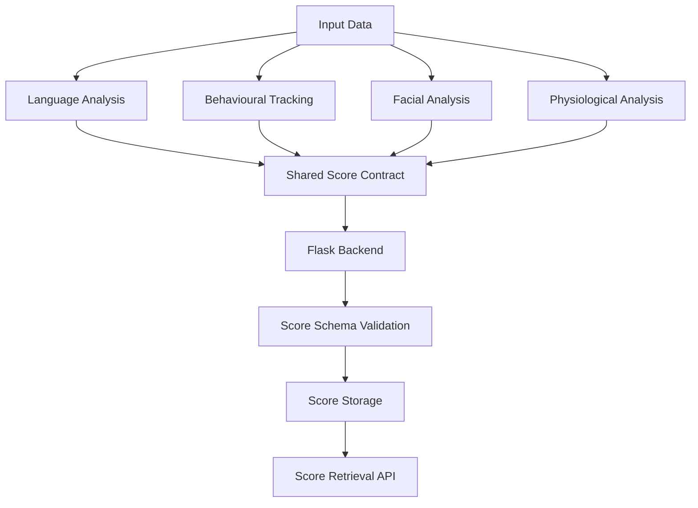

# AI-Powered Holistic Mental Health Assessment and Monitoring Framework

**Project ID:** J26-IT-402

**Repository:** [Rashminavo/J26-IT-402](https://github.com/Rashminavo/J26-IT-402)

## 1. Project Overview

The **AI-Powered Holistic Mental Health Assessment and Monitoring Framework** is an academic research project that explores how multiple sources of information can be analysed through separate software components and represented using a shared backend interface.

The framework is organized around four complementary components:

1. **Language Analysis** – analyses text-based linguistic and sentiment-related information.
2. **Behavioural Tracking** – considers behavioural indicators, such as device usage patterns and screen-time history.
3. **Facial Emotion and Micro-Expression Analysis** – explores facial image and video sequences, facial feature extraction, temporal movement patterns, and micro-expression-related evidence.
4. **Physiological Analysis** – works with physiological measurements and related signals.

A Flask-based backend provides API endpoints for communication with these components. A shared JSON Schema defines the structure of component scores, supporting consistent data exchange across the framework.

The project separates individual component analysis, backend communication, and research evaluation so that each area can be studied and tested independently.

## 2. Project Objectives

The main objectives of this project are to:

- Explore different data sources that may contribute to a holistic understanding of mental well-being.
- Organize the system into independently testable software components.
- Provide a common API interface for communication between the components and the backend.
- Define a shared score contract using JSON Schema.
- Support research experimentation and reproducible model evaluation.
- Represent unavailable or unvalidated evidence appropriately rather than inventing scores or confidence values.
- Consider the limitations, reliability, privacy, and responsible use of AI-based analysis.

## 3. System Architecture

The following diagram illustrates the main component boundaries and backend communication flow.



The shared score contract provides a consistent structure for component outputs. The backend validates submitted scores against the shared JSON Schema and makes accepted scores available through its API.

The architecture does not imply that every research model is combined into a single prediction pipeline or that the framework provides a clinically validated diagnosis.

## 4. System Components

### 4.1 Language Analysis

The Language Analysis component focuses on text-based information and linguistic or sentiment-related patterns. It provides a structured way to represent text-analysis evidence for communication with the wider framework.

Text-based analysis can be influenced by context, language, writing style, and individual differences. Therefore, it should not be treated as a standalone clinical assessment.

### 4.2 Behavioural Tracking

The Behavioural Tracking component considers behavioural indicators such as device or application usage patterns and historical screen-time measurements.

Behavioural information may help describe patterns and changes over time. However, these indicators can be affected by daily routines, work, education, personal circumstances, and other contextual factors.

### 4.3 Facial Emotion and Micro-Expression Analysis

The Facial Emotion and Micro-Expression Analysis component focuses on facial image or video sequences. Its research scope includes face detection, facial-region preprocessing, temporal frame selection, feature extraction, and the analysis of facial movement patterns.

The research workflow explores MobileNetV3-Large-based feature extraction and temporal facial movement features, including optical-flow-based experiments using the CASME II micro-expression dataset.

Research dataset results must be interpreted within the evaluation protocol used. Performance on a facial-expression dataset does not establish equivalent performance in real-world mental-health assessment.

Facial expressions are indirect and context-dependent signals. They cannot definitively establish a person's emotions, mental state, or clinical condition.

### 4.4 Physiological Analysis

The Physiological Analysis component focuses on physiological measurements and related signals that may be relevant to research into mental well-being.

It provides a component boundary for processing and representing physiological evidence in a structured format. Physiological measurements can be influenced by physical activity, the environment, health conditions, sensor quality, and other factors.

They should not independently be treated as proof of a mental-health condition.

### 4.5 Component Integration

The components use a shared backend interface to exchange structured data. The common score schema defines the expected representation of component outputs.

This approach supports consistent communication between components while preserving the distinction between individual research outputs and any broader interpretation of combined evidence.

## 5. Technology Stack

The project uses the following technologies and tools:

- **Programming Language:** Python
- **Backend Framework:** Flask
- **Data Validation:** JSON Schema
- **Testing Framework:** pytest
- **Computer Vision:** OpenCV
- **Numerical Processing:** NumPy
- **Language Analysis:** NLTK
- **Facial Feature Extraction Research:** MobileNetV3-Large
- **Version Control:** Git and GitHub

Additional dependencies may be required for individual research experiments, dataset processing, and model evaluation. Refer to the relevant component dependency files for their requirements.

## 6. Repository Structure

The main repository is organized into backend, component, and integration areas.

```text
J26-IT-402/
├── backend/
│   ├── app/
│   │   ├── api/
│   │   ├── models/
│   │   ├── schemas/
│   │   ├── services/
│   │   ├── config.py
│   │   └── main.py
│   ├── tests/
│   └── requirements.txt
├── components/
│   ├── language-analysis/
│   │   ├── src/
│   │   ├── tests/
│   │   ├── pyproject.toml
│   │   └── requirements.txt
│   ├── behavioural-tracking/
│   │   ├── src/
│   │   ├── tests/
│   │   ├── pyproject.toml
│   │   └── requirements.txt
│   ├── facial-analysis/
│   │   ├── src/
│   │   ├── tests/
│   │   ├── pyproject.toml
│   │   └── requirements.txt
│   └── physiological-analysis/
│       ├── src/
│       ├── tests/
│       ├── pyproject.toml
│       └── requirements.txt
├── integration/
│   ├── score-interface/
│   │   └── score-schema.json
│   ├── api/
│   └── fusion-engine/
├── docs/
│   └── architecture/
├── pytest.ini
├── .gitignore
└── README.md
```

This is a high-level view of the repository. Refer to the source files and tests in each directory for the relevant implementation details.

## 7. Getting Started

### Prerequisites

Install Python and Git on your computer before setting up the project.

Python version requirements and additional dependencies may vary by component. Check the component package metadata and requirements files when selecting your environment.

### Step 1: Clone the Repository

Open a terminal and run:

```powershell
git clone https://github.com/Rashminavo/J26-IT-402.git
Set-Location .\J26-IT-402
```

### Step 2: Create a Virtual Environment

For Windows PowerShell:

```powershell
python -m venv .venv
.\.venv\Scripts\Activate.ps1
python -m pip install --upgrade pip
```

If PowerShell does not allow virtual-environment activation, use the virtual environment's Python executable directly or follow the appropriate activation-policy guidance for your computer.

### Step 3: Install Backend Dependencies

From the repository root, run:

```powershell
python -m pip install -r backend\requirements.txt
```

### Step 4: Install Component Packages

Install the component packages required for your work:

```powershell
python -m pip install -e .\components\language-analysis
python -m pip install -e .\components\behavioural-tracking
python -m pip install -e .\components\physiological-analysis
python -m pip install -e .\components\facial-analysis
```

Research experiments may require additional libraries, datasets, or pretrained model weights beyond the backend dependencies.

### Step 5: Start the Backend

From the repository root, run:

```powershell
Set-Location .\backend
python -m app.main
```

The backend development server uses `http://127.0.0.1:5000` by default.

Keep the terminal running while making API requests.

### Step 6: Check Backend Health

Open a second PowerShell terminal and run:

```powershell
Invoke-RestMethod -Method Get -Uri "http://127.0.0.1:5000/health"
```

The health endpoint provides information about the backend service.

## 8. Backend API Reference

The backend exposes its versioned API under the `/api/v1` prefix.

| Method | Endpoint | Purpose |
|---|---|---|
| GET | `/health` | Checks backend availability. |
| POST | `/api/v1/language/analyze` | Submits input for language analysis. |
| POST | `/api/v1/behavioural/analyze` | Submits behavioural information for analysis. |
| POST | `/api/v1/physiological/analyze` | Submits physiological measurements for analysis. |
| POST | `/api/v1/facial/analyze` | Submits facial frame information for analysis. |
| POST | `/api/v1/scores` | Submits a score conforming to the shared score schema. |
| GET | `/api/v1/scores` | Retrieves scores held by the backend process. |
| GET | `/api/v1/scores/{observation_id}` | Retrieves a score using its observation ID. |

### Language Analysis Request

The language endpoint accepts JSON containing the required text and observation identifiers.

Example request structure:

```json
{
  "text": "Example text for language analysis",
  "observation_id": "observation-001",
  "user_id": "user-001"
}
```

An optional `session_id` may also be supplied.

### Behavioural Tracking Request

The behavioural endpoint uses JSON fields representing behavioural input and historical screen-time information.

Example request structure:

```json
{
  "raw_data": {},
  "historical_screen_times": [],
  "observation_id": "observation-002",
  "user_id": "user-001"
}
```

The exact field contents must conform to the input contract expected by the component.

### Physiological Analysis Request

The physiological endpoint accepts physiological measurements and observation identifiers.

Example request structure:

```json
{
  "measurements": {},
  "observation_id": "observation-003",
  "user_id": "user-001"
}
```

The measurement structure should follow the input requirements of the relevant component.

### Facial Analysis Request

The facial endpoint accepts frame information and bounding boxes in JSON.

Example request structure:

```json
{
  "frames": [],
  "bounding_boxes": [],
  "observation_id": "observation-004",
  "user_id": "user-001"
}
```

An optional `session_id` may also be supplied.

The `frames` and `bounding_boxes` arrays must have matching lengths. Refer to the facial component's input contract for the required frame representation.

**Important:** The backend facial endpoint expects frame data and bounding boxes in JSON. It is not itself a multipart image or video upload endpoint. A browser-based upload interface would require a separate layer to receive an image or video and prepare the frame data for the API.

### Check Backend Scores

To retrieve scores from the running backend:

```powershell
Invoke-RestMethod -Method Get -Uri "http://127.0.0.1:5000/api/v1/scores"
```

To retrieve a particular observation score, replace the example ID with the relevant observation ID:

```powershell
Invoke-RestMethod -Method Get -Uri "http://127.0.0.1:5000/api/v1/scores/observation-001"
```

The backend score store uses in-memory storage. Scores held in this store are not preserved after the backend process stops or restarts.

## 9. Shared Score Interface

The shared score schema is located at:

[`integration/score-interface/score-schema.json`](integration/score-interface/score-schema.json)

The schema defines the expected structure of score data exchanged between components and the backend.

It supports a consistent representation of information such as observation identifiers, user identifiers, component information, timestamps, data status, score values, and confidence fields, according to the schema.

The backend uses schema validation to check submitted scores before accepting them.

Unavailable or unvalidated information should be represented according to the schema rather than replaced with invented values. Optional or nullable fields must be handled in accordance with their definitions.

## 10. Testing

The project uses pytest for automated tests.

Run the repository test suite from the project root:

```powershell
python -m pytest
```

To display a shorter test summary:

```powershell
python -m pytest -q
```

To run individual component tests, specify the relevant test directory. For example:

```powershell
python -m pytest components\facial-analysis\tests
python -m pytest components\language-analysis\tests
```

Tests help verify the software behaviour covered by the test cases. Passing software tests does not, by itself, establish clinical validity or real-world mental-health prediction performance.

## 11. Research Data and Reproducibility

Research experiments may use external datasets, annotation files, pretrained weights, and generated experiment outputs. These resources may not be included in the Git repository or installed through the standard setup commands.

For responsible research and reproducibility:

- Obtain datasets through their approved distribution channels.
- Follow dataset licences and research-use restrictions.
- Avoid committing private user data, raw participant images, video recordings, physiological recordings, or credentials.
- Do not redistribute or publish restricted dataset material without permission.
- Keep evaluation protocols, data splits, random seeds, and experiment outputs documented.
- Use versioned output folders to preserve historical experimental results.
- Report appropriate evaluation metrics and explain the evaluation protocol.
- Do not interpret research dataset performance as clinical accuracy.

## 12. Safety, Ethics, and Limitations

This project is intended for academic research and software development. It is not a medical device, does not replace a qualified healthcare professional, and should not be used as a standalone diagnostic system.

Language patterns, behavioural indicators, facial movements, and physiological measurements are indirect sources of information. Each may be affected by individual differences, context, data quality, and other factors.

The following principles should guide the development and evaluation of the framework:

- Do not invent clinical thresholds, fusion weights, confidence values, or risk scores.
- Distinguish unavailable information from validated evidence.
- Preserve missing or unvalidated outputs as unavailable where the shared contract permits.
- Separate proposal requirements, research-supported decisions, engineering choices, and placeholders.
- Evaluate models using appropriate protocols and metrics.
- Consider privacy, consent, data protection, and dataset restrictions when handling sensitive information.
- Do not make diagnostic claims solely from an individual component's output.

## 13. Development Workflow

To support coordinated development across the project:

- Work on separate feature branches rather than committing directly to `main`.
- Coordinate changes to shared contracts with affected components.
- Add or update tests when changing component behaviour or API interfaces.
- Run relevant tests before proposing changes for integration.
- Keep research datasets and generated experimental outputs separate from version-controlled source code when appropriate.
- Preserve historical results and avoid overwriting previous experiment outputs.
- Document how research results were obtained and which evaluation protocol was used.

## 14. Contributing

Contributors should coordinate component inputs, output formats, dependency requirements, and shared API contracts before making cross-component changes.

When submitting changes, explain the purpose of the change, the relevant files, the tests performed, and any research evaluation details needed to reproduce the results.

## 15. Repository

**GitHub Repository:** [https://github.com/Rashminavo/J26-IT-402](https://github.com/Rashminavo/J26-IT-402)


---

*This documentation describes the project architecture, component responsibilities, backend interfaces, and research considerations. Refer to the relevant source code and component contracts for exact input requirements and behaviour.*
